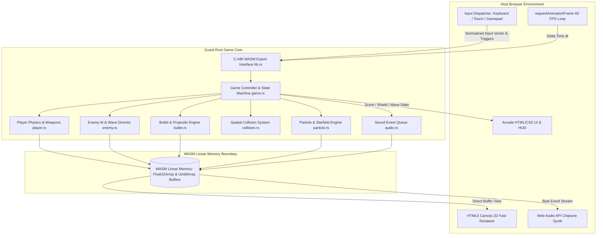

# Architecture Specification: Cosmic Defender WASM (Project #100)

## 1. System Overview & Architectural Topology

`Cosmic Defender WASM` is structured around a decoupled **Rust WebAssembly Core (Guest)** and a **JavaScript/Canvas/WebAudio Presentation Layer (Host)** communicating through a zero-copy linear memory bridge.



---

## 2. Component Architecture

### 2.1 Rust Guest Engine Modules (`src/`)

| Module | Responsibility | Key Structs & Types |
| :--- | :--- | :--- |
| **`lib.rs`** | C-ABI WASM bindings, global lifecycle, memory buffer export points | `init_game`, `update_game`, `get_*_buffer_ptr`, `get_*_count` |
| **`game.rs`** | Top-level state machine (`Menu`, `Playing`, `Paused`, `GameOver`), wave progression, screen-shake, score & combo calculation | `Game`, `GameState` |
| **`player.rs`** | Player movement physics, velocity damping, weapon firing modes, shield regeneration, EMP super-weapon discharge | `Player`, `WeaponType` |
| **`enemy.rs`** | Enemy archetypes (`Scout`, `Corvette`, `Kamikaze`, `Dreadnought`, `Boss`), boss phase transitions, powerup drop logic | `Enemy`, `EnemyType`, `Powerup`, `PowerupType` |
| **`bullet.rs`** | Projectile kinematics, life counters, boundary culling | `Bullet`, `BulletOwner`, `BulletType` |
| **`collision.rs`** | Fast circle-circle, circle-rect, and point containment algorithms | `Circle`, `Rect` |
| **`particle.rs`** | 2D particle simulation (sparks, debris, shockwaves) and 3-layer parallax starfield | `ParticleSystem`, `Particle`, `Star`, `ParticleType` |
| **`audio.rs`** | Fixed-capacity FIFO sound event queue | `AudioQueue`, `SoundEvent` |

---

## 3. WASM Memory & Zero-Copy Interop Protocol

To avoid JSON parsing and garbage-collected object allocations every frame, data is transferred via direct contiguous array slices in WASM linear memory:

```
+-----------------------------------------------------------------------------+
|                          WASM Linear Memory Layout                          |
+-----------------------------------------------------------------------------+
| Stars Buffer:     [ x, y, size, brightness ] x N (4 floats per star)        |
| Enemies Buffer:   [ x, y, radius, type, health, max_hp, phase ] x M (7 f32) |
| Bullets Buffer:   [ x, y, radius, owner, bullet_type ] x K (5 floats/bullet)|
| Particles Buffer: [ x, y, size, life_ratio, r, g, b, type ] x P (8 floats) |
| Powerups Buffer:  [ x, y, radius, type ] x Q (4 floats per powerup)        |
| Sound Events:     [ event_id_0, event_id_1, ... ] (1 byte per event)        |
+-----------------------------------------------------------------------------+
```

### 3.1 Host Memory Access Pattern
1. JavaScript invokes `wasmExports.update_game(dt, dx, dy, is_firing)`.
2. JavaScript queries buffer pointer (`wasmExports.get_*_buffer_ptr()`) and count (`wasmExports.get_*_count()`).
3. A typed array view (`new Float32Array(wasmMemory.buffer, ptr, count * stride)`) is constructed **without copying memory**.
4. The canvas render loop consumes coordinates directly from the array view.

---

## 4. Web Presentation Architecture (`www/`)

### 4.1 HTML5 Canvas Rendering Pipeline
1. **Clear & Shake**: Background fill with camera offset transformation computed from `get_screen_shake()`.
2. **Background Stars**: 3 parallax layers rendered with variable alpha.
3. **Particle Simulation**: Sparks, debris particles, and expanding EMP shockwave vector rings.
4. **Powerup Collectibles**: Color-coded badges with floating icon glyphs.
5. **Projectiles**: High-intensity glow bullets (player lasers in neon cyan, plasma in emerald green, enemy pulses in orange/red).
6. **Enemies**: Dynamic vector hulls and health bars for boss/dreadnought encounters.
7. **Player Ship**: Responsive cyan hull, glowing thrusters, cockpit canopy, and shield aura.

### 4.2 Web Audio Synthesis Engine
Sound events emitted by Rust are decoded into procedural audio graphs using the Web Audio API:
- **Oscillator Nodes**: `sawtooth`, `square`, `sine`, `triangle`.
- **Gain Nodes**: Exponential envelope decay curves (`setValueAtTime`, `exponentialRampToValueAtTime`).
- **Biquad Filters**: Dynamic low-pass resonant filtering for explosions and EMP sweeps.
- **Audio Buffers**: Procedural white-noise generators for explosion impact crunches.
- **BGM Arpeggiator**: Lightweight 8-step bassline loop running in JS timer intervals.

---

## 5. Input Subsystem Architecture

The Input Dispatcher normalizes all input paradigms into a standard normalized 2D movement vector `(dx, dy)` and binary action flags (`fire`, `emp`):

```mermaid
graph LR
    K[Keyboard WASD/Arrows] --> N[Input Normalizer]
    G[HTML5 Gamepad API] --> N
    T[Touch Controller] --> N
    M[Mouse / Canvas Drag] --> N
    N -->|dx, dy: [-1.0, 1.0]| SIM[WASM Simulation Step]
    N -->|fire, emp flags| SIM
```

- **Gamepad Polling**: Reads standard Gamepad mapping (Axis 0/1 for motion, Button 0/7 for fire, Button 1/6 for EMP).
- **Smooth Inertia**: Rust applies acceleration and damping (`target_v = input * speed; v += (target_v - v) * (15.0 * dt)`).
